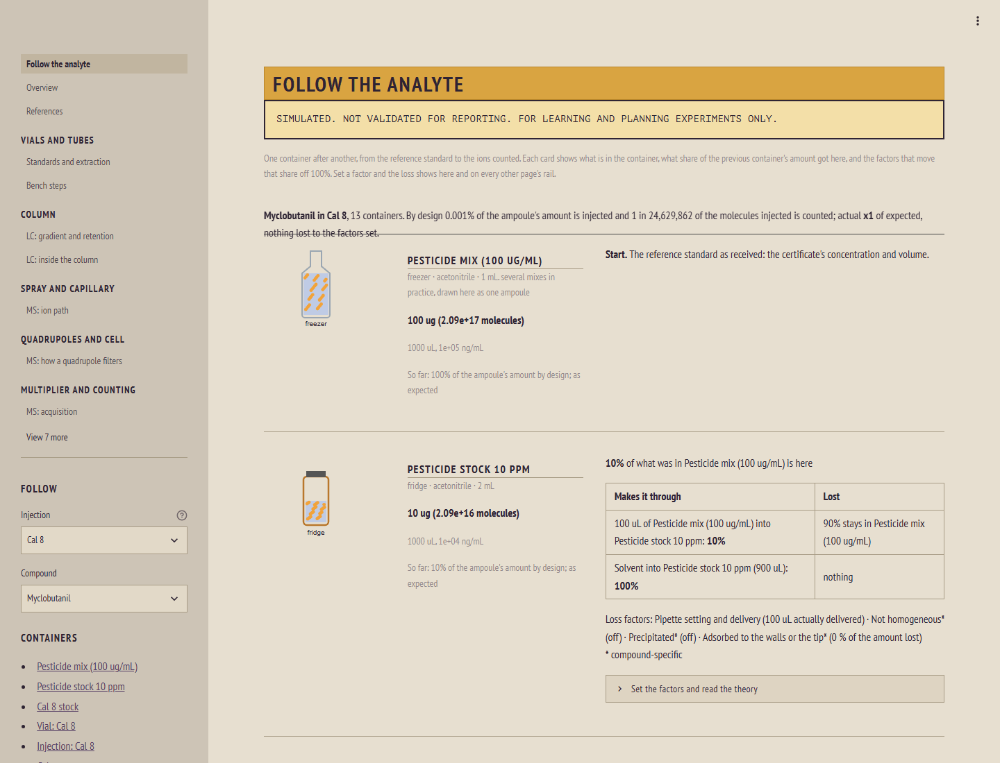
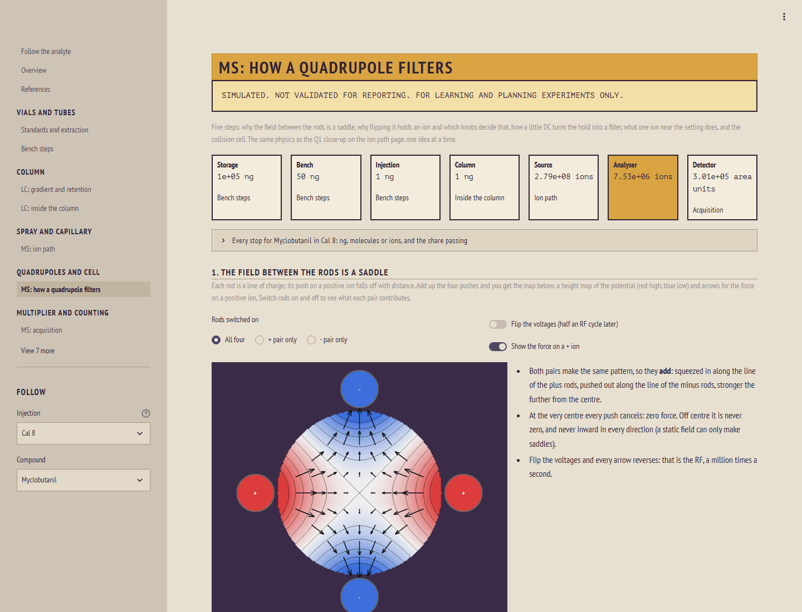
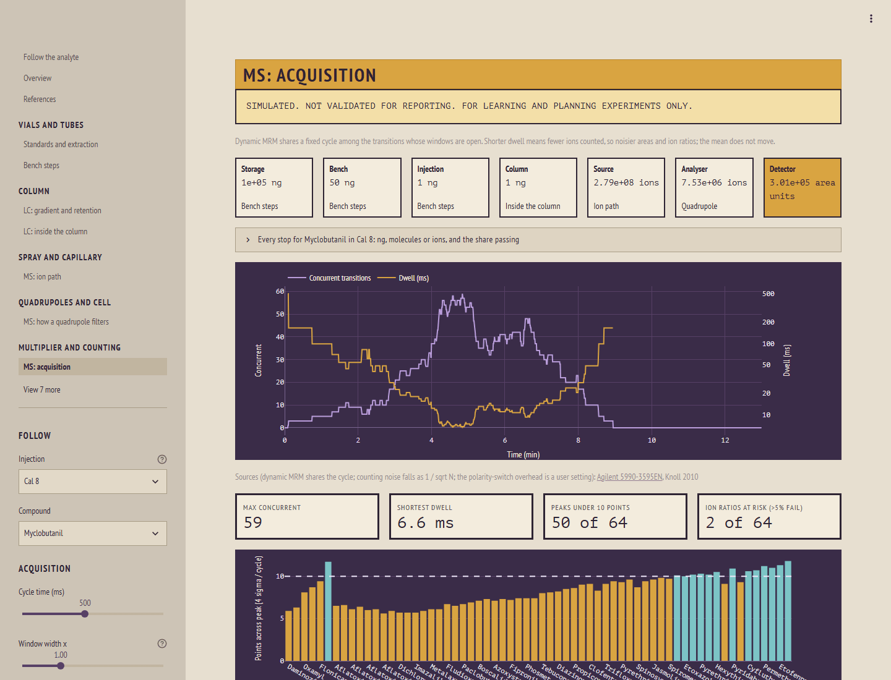
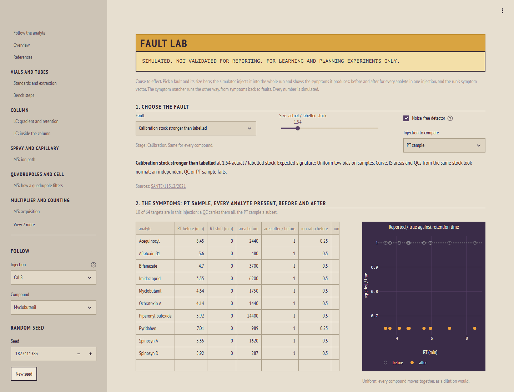

# LC-MS/MS simulator: pesticides and mycotoxins in cannabis

An interactive model of a reversed-phase gradient LC-MS/MS method on a triple quadrupole, built for teaching and
troubleshooting. Pick one compound in one injection and follow it from the reference-standard ampoule to the
peak area: every pipetting step, the column, the spray, both quadrupoles, the collision cell and the ion counts.
Then break something (a pipette, the dwell volume, the mobile phase pH, the internal standard) and watch which
results move and which checks would catch it.

**Live app:** [lcms-simulator-lebeau.streamlit.app](https://lcms-simulator-lebeau.streamlit.app/) (if nobody has
used it for a while it takes a minute to wake up)

> **Simulated.** Nothing here is validated for reporting. The outputs must never be used on a certificate of
> analysis or in place of a laboratory's own method validation.



<table>
<tr>
<td width="33%"><a href="docs/img/quadrupole.png"></a></td>
<td width="33%"><a href="docs/img/acquisition.png"></a></td>
<td width="33%"><a href="docs/img/fault_lab.png"></a></td>
</tr>
<tr>
<td>The quadrupole, one step at a time</td>
<td>Dynamic MRM: dwell and points per peak</td>
<td>Fault lab: inject a fault, read its symptoms</td>
</tr>
</table>

## What it does

- **Follow the analyte.** One card per container, from the ampoule to the counted ions, with the share of the
  amount that arrives at each and the loss factors that move it off 100%. Every value is a nominal / actual pair:
  the signal uses what really happened, the reported result uses what was written down.
- **Inside the column.** Where every band sits along the column at a chosen moment, the %B around it, and the
  molecules themselves in 3D, coloured by each atom's share of log P, with a C18 surface showing how long each one
  is held.
- **The ion path and the quadrupole.** The spray and desolvation, a quadrupole's stability diagram with one ion
  driven through computed rod paths, and a collision cell with nitrogen collisions.
- **Acquisition.** The dynamic MRM schedule: dwell, points per peak, Poisson counting and ion-ratio precision, and
  crosstalk between transitions that share ions.
- **Calibration and the result.** Calibrators through the detector model, weighting, internal standard
  correction, matrix effects, and one sample from the balance to the reported result.
- **Troubleshooting.** A fault library (19 named faults, each a change to one stage's inputs), a fault lab that
  injects one at a chosen size, and a symptom matcher that ranks faults from what a batch shows and names the
  bench check that would separate the leading candidates.
- **Your data.** Import any vendor's quant export or MRM transition table by naming its columns, and read the
  batch's symptoms for the matcher. On the hosted copy files stay in your browser session; nothing is saved.

## How it is built

- A physics layer turns conditions into peak areas; a quantitation layer turns areas into a reported
  concentration. Data flows one way. A fault is a named change to one stage's inputs; the pipeline never changes.
- Retention follows the linear solvent strength model, solved exactly segment by segment for any gradient with
  the dwell delay; peak widths, dMRM scheduling, ion counting, calibration and internal-standard correction each
  have a model note in [docs/](docs/) with its equations, assumptions and sources.
- Every input carries its provenance (measured, fitted or assumed), and the pages show it. Every claim cites a
  source in [docs/references.md](docs/references.md), with how and when the source was checked; a claim with no
  adequate source stays labelled "assumed".
- About 400 tests, including oracle tests: closed-form solutions where they exist, conservation of amounts through
  every bench step, and a bias relation that each fault must reproduce.

## The example method and its data

The bundled method is Agilent application note 5994-1734EN (pesticides and mycotoxins in cannabis flower on a
1260 Infinity II LC and an Ultivo triple quadrupole) applied to the Minnesota Office of Cannabis Management's
regulated list: the note's transitions, retention times, column, gradient, source settings and sample preparation.
The note uses no internal standards and gives no calibration or QC levels, so those are assumed and labelled so;
[data/examples/method.yaml](data/examples/method.yaml) lists where every input comes from.

Sources of bundled data: the application note (values extracted from its tables; the PDF itself is not
included), the Minnesota OCM Cannabis Technical Authority v2.0 (analytes and action limits), and PubChem
(structures and XLogP3). The full list is in [docs/references.md](docs/references.md).

The model was developed against a production method of the same kind; that laboratory's documents and data are not
part of this repository.

## Run it locally

Python 3.11 or later.

```bash
python -m venv .venv
.venv/Scripts/python -m pip install -e ".[app,dev]"     # .venv/bin/python on macOS and Linux
.venv/Scripts/python scripts/run_app.py                 # http://localhost:8599
.venv/Scripts/python -m pytest -q
```

Run locally, the Import page can also save to `data/lab/` (ignored by git) and switch the app to your own input
set.

## Author

Luke LeBeau, analytical chemist (LC-MS/MS pesticide and mycotoxin testing).

Built with Claude Code (Anthropic) as a coding assistant. The scope, the chemistry and model choices, the
checks against real instrument data and the review of every result are the author's; much of the code was
written by the assistant under that direction.

## Licence

MIT; see [LICENSE](LICENSE).
